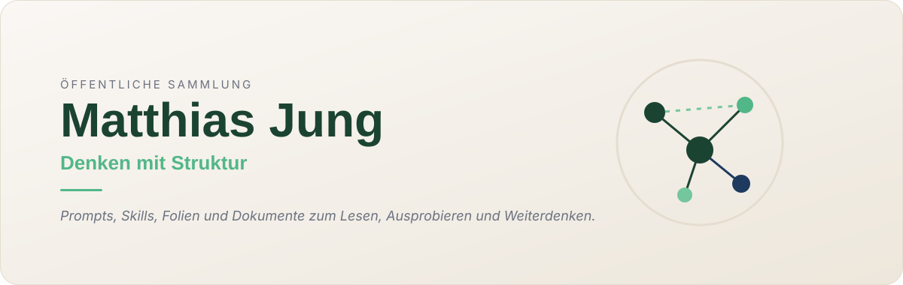
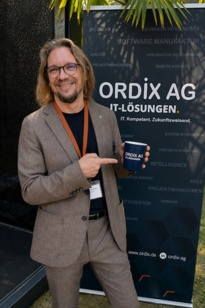

  

  <strong>Chief Transformation Officer (CTrO)</strong>

  <em>Meine Mission: Aus Daten Informationen formen, aus Informationen Erkenntnisse gewinnen und aus Erkenntnissen digitale Wirkung entfalten.</em>

  
  
  
  
  

 

## Willkommen

Schön, dass du hier bist. In diesem Repository teile ich, was in meiner Arbeit mit Daten, KI und Transformation entsteht: Prompts, die ich täglich nutze, Skills für Agenten, Folien aus meinen Vorträgen und Dokumente zum Nachlesen.

Alles liegt offen und strukturiert vor. Nimm es als Werkzeug, nicht als Ersatz fürs eigene Denken: ausprobieren, anpassen, weiterentwickeln.

 

## Entdecken

<table>
  <tr>
    <td width="50%" valign="top">
      <h3>📚 Prompts</h3>
      Erprobte Prompts und Vorlagen für Sprachmodelle, sortiert nach Thema und mit Hinweisen zum Einsatz.
        
      <a href="prompts/"><strong>Zu den Prompts →</strong></a>
    </td>
    <td width="50%" valign="top">
      <h3>🧩 Skills</h3>
      Wiederverwendbare Skills für Claude und andere Agenten, jeweils mit <code>SKILL.md</code> und Hilfsdateien.
        
      <a href="skills/"><strong>Zu den Skills →</strong></a>
    </td>
  </tr>
  <tr>
    <td width="50%" valign="top">
      <h3>🎤 Folien</h3>
      Folien aus Vorträgen, Webinaren und Workshops, geordnet nach Jahr und Anlass.
        
      <a href="folien/"><strong>Zu den Folien →</strong></a>
    </td>
    <td width="50%" valign="top">
      <h3>📄 Dokumente</h3>
      Artikel, Checklisten und Handouts zum Nachlesen und Weitergeben.
        
      <a href="dokumente/"><strong>Zu den Dokumenten →</strong></a>
    </td>
  </tr>
</table>

 

## Profil

<table>
  <tr>
    <td width="34%" valign="top">
      
    </td>
    <td valign="top">
      
Matthias Jung ist Consultant und CTrO mit über 24 Jahren Erfahrung in der Konzeption und dem Betrieb komplexer Datenbankinfrastrukturen. Als Oracle ACE mit dem Schwerpunkt MySQL zählt er zu den profiliertesten MySQL- und MariaDB-Experten im deutschsprachigen Raum und hat als Mitgründer der DOAG SIG MySQL die deutsche Datenbank-Community maßgeblich mitgeprägt.

      
Heute berät er Organisationen beim strategischen Aufbau von Data Governance, datengetriebenen Prozessen und moderner Digital Transformation, mit dem Anspruch, aus Daten nicht nur Informationen, sondern belastbare Entscheidungsgrundlagen zu machen. Als gefragter Konferenzsprecher auf DOAG, TDWI und IT-Tage verbindet er technische Tiefe mit dem Blick für organisatorische und kulturelle Veränderungsprozesse.

    </td>
  </tr>
</table>

<table>
  <tr>
    <td align="center" width="25%"><h2>407</h2>PUBLIKATIONEN</td>
    <td align="center" width="25%"><h2>119</h2>BLOG-ARTIKEL</td>
    <td align="center" width="25%"><h2>31</h2>VORTRÄGE</td>
    <td align="center" width="25%"><h2>24</h2>JAHRE</td>
  </tr>
</table>

Stand: November 2026, laut <a href="https://matthiasjung.net">matthiasjung.net</a>. Alle Publikationen im <a href="https://matthiasjung.net/catalog.html">Publikationskatalog</a>.

 

## Bücher

| | |
|---|---|
| **Sich die Antwort verdienen** · *Oktober 2026* | Wie du mit KI wächst, statt an ihr zu verkümmern. Praxisbuch zum GenAI Guardrail Framework, gemeinsam mit Tobias Flüter. [Bestellen](https://amzn.eu/d/0cUq4ZgL) |
| **Think with AI** · *Juli 2026* | KI nicht als Ersatz für Denken, sondern als Werkzeug, das unsere Fähigkeiten stärkt. [Zum Buch](https://thinkwithai.matthiasjung.net) |
| **Think with Data** | Ein Data-Literacy-Buch für den Alltag. Daten sollten unser Denken unterstützen, nicht manipulieren. [Zum Buch](https://thinkwithdata.matthiasjung.net) |

 

## Themen, Plattformen, Netzwerk

**Meine Themen:** [MySQL & MariaDB](https://matthiasjung.net/mysql.html) · Data Governance · AI Literacy · Digital Transformation

**Meine Plattformen:** [LinkedIn](https://www.linkedin.com/in/matthias-jung-ordixag/) · [ORDIX Blog](https://blog.ordix.de/matthias-jung) · [Notes](https://notes.matthiasjung.net) · [Concepts](https://concepts.matthiasjung.net) · [Publikationskatalog](https://matthiasjung.net/catalog.html)

**Mein Netzwerk:** Oracle ACE · DOAG · TDWI · IT-Tage · ORDIX

 

## Lass uns sprechen

Interessiert an Zusammenarbeit oder Beratung? Ich freue mich auf den Austausch mit dir.

 

## Lizenz

Die Inhalte dieses Repositorys stehen unter [CC BY-NC 4.0](https://creativecommons.org/licenses/by-nc/4.0/deed.de). Du darfst sie teilen und bearbeiten, solange du mich als Urheber nennst und sie nicht kommerziell nutzt. Den vollständigen Text findest du in [`LICENSE`](LICENSE).

Für eine kommerzielle Nutzung sprich mich gerne an.

---

  
    <a href="https://matthiasjung.net">matthiasjung.net</a> ·
    <a href="https://thinkwithai.matthiasjung.net">Think with AI</a> ·
    <a href="https://thinkwithdata.matthiasjung.net">Think with Data</a> ·
    <a href="https://notes.matthiasjung.net">Notes</a> ·
    <a href="https://speaker.matthiasjung.net">Speaker</a> ·
    <a href="https://concepts.matthiasjung.net">Concepts</a> ·
    <a href="https://blog.ordix.de/matthias-jung">ORDIX Blog</a>
  

